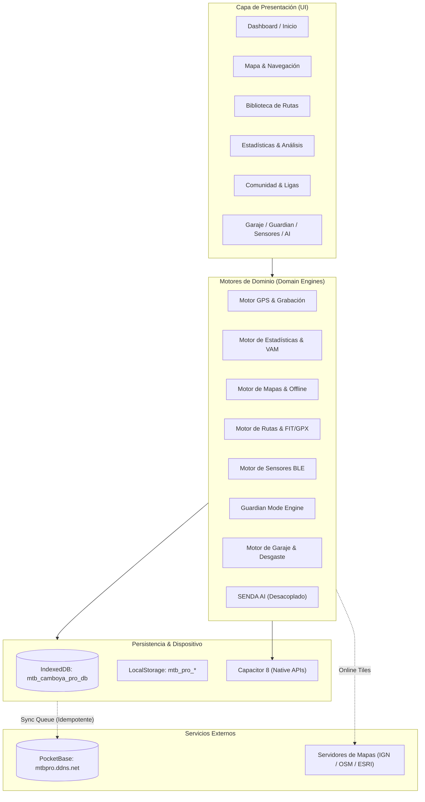

# senda-mtb — Arquitectura del Sistema (ARCHITECTURE.md)

**Versión:** 1.0  
**Fecha:** 16 de noviembre de 2026  
**Referencia:** Documento Maestro del Proyecto senda-mtb  

---

## 1. Principios de Diseño Arquitectónico

La arquitectura de **senda-mtb** sigue un diseño modular, ligero y desacoplado, concebido bajo los siguientes pilares:

1. **Local-First & Offline-First:** Toda la funcionalidad crítica (captura GPS, persistencia de telemetría, visor de mapas descargados, cálculo de estadísticas y consulta de biblioteca) se ejecuta y persiste localmente sin requerir conexión a internet ni autenticación obligatoria.
2. **Separación Estricta de Responsabilidades:** La capa de presentación (UI) nunca accede directamente al almacenamiento en disco ni al backend. Consume exclusivamente los motores de dominio y repositorios locales.
3. **Flujo Unidireccional de Datos:** Las acciones del usuario disparan eventos en los motores de dominio, los cuales actualizan el estado centralizado y la persistencia; la UI se suscribe a los cambios de estado.
4. **Desacoplamiento del Backend:** El cliente HTTP (`app/cloud.js`) implementa colas de sincronización con identificadores únicos e idempotencia, reintentos con backoff exponencial y tolerancia a caídas del servidor.



---

## 2. Capas de la Aplicación

### 2.1. Capa de Presentación (UI)
* Desarrollada con HTML5 semántico, CSS3 modular (con variables para el tema oscuro oficial) y JavaScript moderno (ES2022).
* Interfaces optimizadas para interacción en ruta: controles táctiles grandes, alta visibilidad, soporte de pantalla completa y retención de pantalla encendida (*Wake Lock*).
* Gráficos interactivos de telemetría y zonas de esfuerzo renderizados mediante **Chart.js** empaquetado en local.

### 2.2. Capa de Motores de Dominio (Domain Engines)
Módulos JavaScript puros, sin acoplamiento a elementos específicos del DOM, facilitando pruebas unitarias exhaustivas con `node --test`:
* **`statistics-engine.js`:** Algoritmos de filtrado geodésico (Haversine), cálculo de distancia, desnivel acumulado filtrado (umbral de 3 m), VAM, y partición en zonas cardíacas y de potencia Coggan.
* **`fit-parser.mjs`:** Parser binario de ficheros FIT de estándares de Garmin/Wahoo/Bryton, empaquetado como módulo IIFE (`MTBFit`).
* **`gps.js` / `recording.js`:** Lógica de estados de grabación (detenido, grabando, pausado, auto-pausado), filtrado de precisión (`MAX_ACC_M = 30`), umbral de avance (`MIN_STEP_M = 4`) y recuperación ante cierre forzoso.
* **`src/ble.js`:** Abstracción nativa de Bluetooth LE que administra sesiones multiplexadas sobre características GATT estándar (Pulsómetro, Cadencia/Velocidad, Potenciómetro).

### 2.3. Capa de Persistencia Local
* **IndexedDB (`mtb_camboya_pro_db`, v2):**
  * `activities`: Actividades registradas por el usuario con telemetría completa.
  * `routes`: Rutas planificadas o importadas.
  * `map_pois`: Puntos de interés creados o descargados.
  * `route_photos`: Fotografías asociadas a coordenadas de ruta en base64/blob.
  * `sync_queue`: Registro de operaciones locales pendientes de subida al backend.
* **LocalStorage (Prefijo estricto `mtb_pro_*`):**
  * Preferencias de usuario, perfil local, tokens de sesión y marcas temporales de sincronización.
  * Garantiza el aislamiento total frente a claves de otras aplicaciones en el mismo origen.

### 2.4. Capa de Servicios Nativos (Capacitor 8)
* `@capacitor-community/background-geolocation`: Adquisición continua de coordenadas en segundo plano mediante servicios Foreground de Android con notificación persistente.
* `@capacitor-community/bluetooth-le`: Comunicación directa con chips Bluetooth mediante la pila nativa de Android.
* `@capacitor/filesystem`: Almacenamiento y exportación de archivos GPX/FIT en el sistema de archivos del dispositivo.
* `@capacitor/share`: Integración con la hoja de compartir nativa del sistema operativo.
* `@capacitor/local-notifications`: Alertas locales de Guardian Mode y avisos de mantenimiento.

### 2.5. Capa de Backend y Sincronización
* **PocketBase (`https://mtbpro.ddns.net`):**
  * Instancia independiente dedicada en exclusiva a senda-mtb.
  * Autenticación basada en Bearer Token persistente.
  * Los hooks de servidor que implementan endpoints de comunidad deben seguir desplegados en PocketBase; su código fuente no se incluye en el repositorio desde v0.2.23.

---

## 3. Estructura de Módulos y Carpetas

El proyecto converge hacia una organización modular estructurada en `app/`:

```
senda-mtb/
├── android/                 # Proyecto nativo Android (Capacitor)
├── app/                     # Lógica de la aplicación
│   ├── config.js            # Configuración global, constantes y límites
│   ├── state.js             # Estado compartido y reactividad
│   ├── storage.js           # Repositorio IndexedDB y migraciones
│   ├── gps.js               # Adquisición GPS y permisos
│   ├── recording.js         # Ciclo de vida de grabación de actividad
│   ├── map.js               # Controlador Leaflet y capas
│   ├── offline-maps.js      # Caché y gestión de teselas offline
│   ├── routes.js            # Gestión de biblioteca de rutas
│   ├── route-following.js   # Navegación y avisos de fuera de ruta
│   ├── route-files.js       # Importador/exportador GPX, KML, GeoJSON
│   ├── statistics-engine.js # Motor matemático de telemetría y métricas
│   ├── stats.js             # Vistas y gráficas de análisis
│   ├── sensors.js           # Controlador de telemetría BLE
│   ├── pois.js              # Puntos de interés MTB
│   ├── cloud.js             # Cliente PocketBase y sincronización
│   ├── groups.js            # Grupos MTB y seguimiento en vivo
│   ├── group-rankings.js    # Clasificaciones y temporadas
│   ├── community-*.js       # Rutas, segmentos y social
│   └── ui.js                # Controladores globales de interfaz
├── scripts/
│   └── prepare-web.js       # Script de build y empaquetado para Capacitor
├── src/
│   ├── ble.js               # Módulo Bluetooth LE compilado con esbuild
│   ├── fit-parser.mjs       # Parser binario FIT compilado con esbuild
│   └── native-app.mjs       # Adaptador nativo Capacitor
├── tests/                   # Suite de pruebas con node --test
├── www/                     # Carpeta de salida compilada para Capacitor
├── capacitor.config.json    # Configuración de appId com.emiliopousada.sendamtb
├── index.html               # Shell de la aplicación
├── package.json             # Dependencias de npm y scripts
├── sw.js                    # Service Worker y políticas de caché
├── PRODUCT_SPEC.md          # Especificación de producto
├── ARCHITECTURE.md          # Este documento
├── DATA_MODEL.md            # Esquemas de datos lógicos y físicos
├── MAP_PROVIDERS.md         # Catálogo de capas y licencias de mapas
└── SECURITY_AND_PRIVACY.md  # Políticas de seguridad y aislamiento
```

---

## 4. Estrategia de Build y Empaquetado

1. **`prepare-web.js`:**
   * Sustituye en `index.html` los enlaces de CDNs por los scripts y estilos locales presentes en `node_modules/` o `vendor/` (Leaflet, Leaflet-Rotate, Chart.js).
   * Compila `src/ble.js`, `src/fit-parser.mjs` y `src/native-app.mjs` a formato IIFE autónomo mediante **esbuild**.
   * Inyecta la versión semántica de `package.json` y el número de build de CI en `app/config.js` y `sw.js`.
   * Verifica la existencia de todos los recursos locales antes de generar `www/`.
2. **Capacitor CLI:**
   * `npx cap sync` copia `www/` al directorio nativo de Android (`android/app/src/main/assets/public`).
   * Compilación a APK nativo mediante Gradle (`gradle assembleDebug`).

