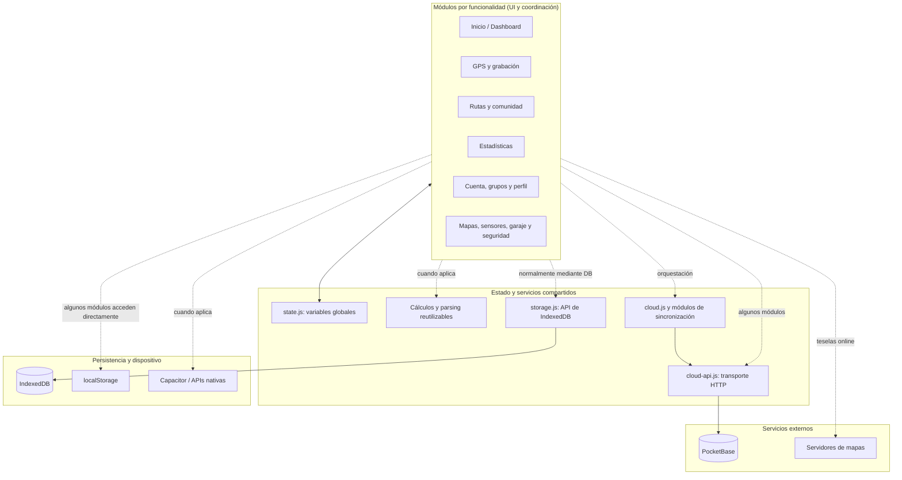

# senda-mtb — Arquitectura del Sistema (ARCHITECTURE.md)

**Versión:** 1.0 · **Fecha:** 24 de noviembre de 2026 · **Referencia:** Documento Maestro del Proyecto senda-mtb

---

## 1. Principios de Diseño Arquitectónico

La arquitectura actual de **senda-mtb** es modular por funcionalidad y se ejecuta principalmente como scripts clásicos que comparten estado global. Hay límites claros en algunas piezas, pero no una separación estricta por capas. Este documento describe el sistema existente y distingue esas fronteras parciales de la dirección recomendada para código nuevo.

1. **Local-First & Offline-First:** La captura GPS, las rutas locales, los mapas descargados y varias consultas siguen funcionando sin conexión. Las funciones que dependen de PocketBase requieren conectividad y, en muchos casos, una sesión.
2. **Módulos por funcionalidad:** Archivos como `recording.js`, `stats.js`, `profile.js` y módulos de comunidad coordinan eventos de UI, estado y llamadas a servicios. Algunos también leen o escriben `localStorage`; por tanto, la separación UI/dominio/datos no es estricta.
3. **Estado compartido:** `state.js` declara variables globales mutables consumidas por varios scripts. El flujo es principalmente imperativo, con listeners de UI y plataforma; no existe un bus de eventos de aplicación ni un almacén reactivo al que la UI solo se suscriba.
4. **Límites parciales:** `storage.js` encapsula operaciones de IndexedDB, `cloud-api.js` centraliza el transporte HTTP, y hay módulos de cálculo y parsing sin acceso al DOM. Otros accesos a `localStorage`, `Cloud` y `cloudApi` permanecen en módulos de funcionalidad.



### Dirección evolutiva (no implementada de forma global)
* Mantener las reglas de negocio nuevas en funciones con entradas y salidas explícitas, sin DOM ni persistencia del navegador, cuando puedan separarse razonablemente.
* Dejar los efectos de UI, red, almacenamiento y APIs nativas en controladores o adaptadores identificables.
* Migrar módulos existentes gradualmente cuando se trabajen, preservando el comportamiento y añadiendo pruebas; no se requiere una reescritura transversal.

---

## 2. Capas de la Aplicación

### 2.1. Capa de Presentación (UI)
* Desarrollada con HTML5 semántico, CSS3 modular (con variables para el tema oscuro oficial) y JavaScript moderno (ES2022).
* Interfaces optimizadas para interacción en ruta: controles táctiles grandes, alta visibilidad, soporte de pantalla completa y retención de pantalla encendida (*Wake Lock*).
* Gráficos interactivos de telemetría y zonas de esfuerzo renderizados mediante **Chart.js** empaquetado en local.
* La presentación no está concentrada en una capa independiente: los controladores y renderizadores viven junto a la coordinación de cada funcionalidad y usan el helper global `$()` y, en algunos casos, selectores DOM directos.

### 2.2. Lógica de dominio y módulos sin DOM
No todo el código de dominio es un motor puro. Los módulos de funcionalidad suelen combinar reglas, estado, efectos del dispositivo y presentación. Las piezas con límites más claros incluyen:
* **`statistics-engine.js`:** Cálculos de distancia, desnivel, VAM y zonas cardíacas/de potencia. No consulta el DOM ni el almacenamiento del navegador.
* **`community-performance.js`:** Cálculos y validaciones de rendimiento comunitario sin dependencias de UI ni persistencia del navegador.
* **`src/fit-parser.mjs`:** Convierte datos FIT en segmentos normalizados sin acceder al DOM ni a `localStorage`; utiliza `fit-file-parser`.
* **`gps.js`, `recording.js`, `stats.js` y módulos de comunidad:** Son controladores/orquestadores de funcionalidad, no motores puros; coordinan estado y servicios y varios interactúan directamente con DOM o almacenamiento.
* **`src/ble.js`:** Adaptador de Bluetooth LE que usa APIs nativas y expone la interfaz mediante `window.MtbBle`; no es un módulo puro.

### 2.3. Capa de Persistencia Local
* **IndexedDB (`mtb_camboya_pro_db`, v2):** Las operaciones se encapsulan principalmente en `app/storage.js` y se exponen mediante `DB`.
  * `routes`: Rutas guardadas, incluidas las grabaciones locales.
  * `kv`: Valores auxiliares de la app.
  * `routePhotos`: Fotografías asociadas a rutas, almacenadas como blobs.
  * `activities`, `map_pois` y `sync_queue` no son object stores de esta base IndexedDB.
* **LocalStorage:** Usa el prefijo `mtb_pro_*` para preferencias, perfil, sesión y datos auxiliares de sincronización. No todo el acceso pasa por un repositorio: varios módulos lo leen o escriben directamente.
* **Credenciales nativas:** En plataformas nativas, el token puede pasar por el almacenamiento seguro de Capacitor; la implementación también conserva compatibilidad con el token heredado en `localStorage`.

### 2.4. Capa de Servicios Nativos (Capacitor 8)
* `@capacitor-community/background-geolocation`: Adquisición continua de coordenadas en segundo plano mediante servicios Foreground de Android con notificación persistente.
* `@capacitor-community/bluetooth-le`: Comunicación directa con chips Bluetooth mediante la pila nativa de Android/iOS.
* `@capacitor/filesystem`: Almacenamiento y exportación de archivos GPX/FIT en el sistema de archivos del dispositivo.
* `@capacitor/share`: Integración con la hoja de compartir nativa del sistema operativo.
* `@capacitor/local-notifications`: Alertas locales de Guardian Mode y avisos de mantenimiento.

### 2.5. Capa de Backend y Sincronización
* **PocketBase (`https://mtbpro.ddns.net`):**
  * Instancia independiente dedicada en exclusiva a senda-mtb.
  * Autenticación basada en Bearer Token, con almacenamiento seguro nativo cuando está disponible.
  * Arquitectura de hooks de servidor (`pb_hooks/`) para validación de reglas de negocio en grupos, apodos, clasificación y limpieza de ubicaciones en directo (`live_cleanup.pb.js`).
* **Cliente y sincronización en la app:** `cloud-api.js` construye las peticiones HTTP; `cloud.js`, `cloud-routes-sync.js` y `cloud-preferences.js` coordinan autenticación, cuenta y sincronización. Los módulos de funcionalidad pueden invocar estas APIs directamente; no hay una única capa de casos de uso que los aísle a todos del backend.

---

## 3. Estructura de Módulos y Carpetas

El proyecto converge hacia una organización modular estructurada en `app/`:

```
senda-mtb/
├── android/                 # Proyecto nativo Android (Capacitor)
├── app/                     # Lógica de la aplicación
│   ├── config.js            # Configuración global, constantes y límites
│   ├── state.js             # Variables de estado global compartidas
│   ├── storage.js           # Repositorio IndexedDB y migraciones
│   ├── gps.js               # Adquisición GPS y permisos
│   ├── recording.js         # Ciclo de vida de grabación de actividad
│   ├── map.js               # Controlador Leaflet y capas
│   ├── offline-maps.js      # Caché y gestión de teselas offline
│   ├── routes.js            # Gestión de biblioteca de rutas
│   ├── route-following.js   # Navegación y avisos de fuera de ruta
│   ├── route-files.js       # Importador/exportador GPX, KML, GeoJSON
│   ├── statistics-engine.js # Motor matemático de telemetría y métricas
│   ├── stats.js             # Vistas y gráficas de análisis
│   ├── sensors.js           # Controlador de telemetría BLE
│   ├── pois.js              # Puntos de interés MTB
│   ├── cloud-api.js         # Helper de peticiones HTTP a PocketBase
│   ├── cloud.js             # Sesión, cuenta y coordinación de autenticación
│   ├── cloud-routes-sync.js # Sincronización de rutas
│   ├── cloud-preferences.js # Sincronización de preferencias
│   ├── groups.js            # Grupos MTB y seguimiento en vivo
│   ├── group-rankings.js    # Clasificaciones y temporadas
│   ├── community-*.js       # Rutas, segmentos y social
│   └── ui.js                # Controladores globales de interfaz
├── pb_hooks/                # Hooks de backend para PocketBase
├── scripts/
│   └── prepare-web.js       # Script de build y empaquetado para Capacitor
├── src/
│   ├── ble.js               # Módulo Bluetooth LE compilado con esbuild
│   ├── fit-parser.mjs       # Parser binario FIT compilado con esbuild
│   └── native-app.mjs       # Adaptador nativo Capacitor
├── tests/                   # Suite de pruebas con node --test
├── www/                     # Carpeta de salida compilada para Capacitor
├── capacitor.config.json    # Configuración de appId com.emiliopousada.sendamtb
├── index.html               # Shell de la aplicación
├── package.json             # Dependencias de npm y scripts
├── sw.js                    # Service Worker y políticas de caché
├── PRODUCT_SPEC.md          # Especificación de producto
├── ARCHITECTURE.md          # Este documento
├── DATA_MODEL.md            # Esquemas de datos lógicos y físicos
├── MAP_PROVIDERS.md         # Catálogo de capas y licencias de mapas
└── SECURITY_AND_PRIVACY.md  # Políticas de seguridad y aislamiento
```

---

## 4. Estrategia de Build y Empaquetado

1. **`prepare-web.js`:**
   * Sustituye en `index.html` los enlaces de CDNs por los scripts y estilos locales presentes en `node_modules/` o `vendor/` (Leaflet, Leaflet-Rotate, Chart.js).
   * Compila `src/ble.js`, `src/fit-parser.mjs` y `src/native-app.mjs` a formato IIFE autónomo mediante **esbuild**.
   * Inyecta la versión semántica de `package.json` y el número de build de CI en `app/config.js` y `sw.js`.
   * Verifica la existencia de todos los recursos locales antes de generar `www/`.
2. **Capacitor CLI:**
   * `npx cap sync` copia `www/` al directorio nativo de Android (`android/app/src/main/assets/public`).
   * Compilación a APK nativo mediante Gradle (`gradle assembleDebug`).

